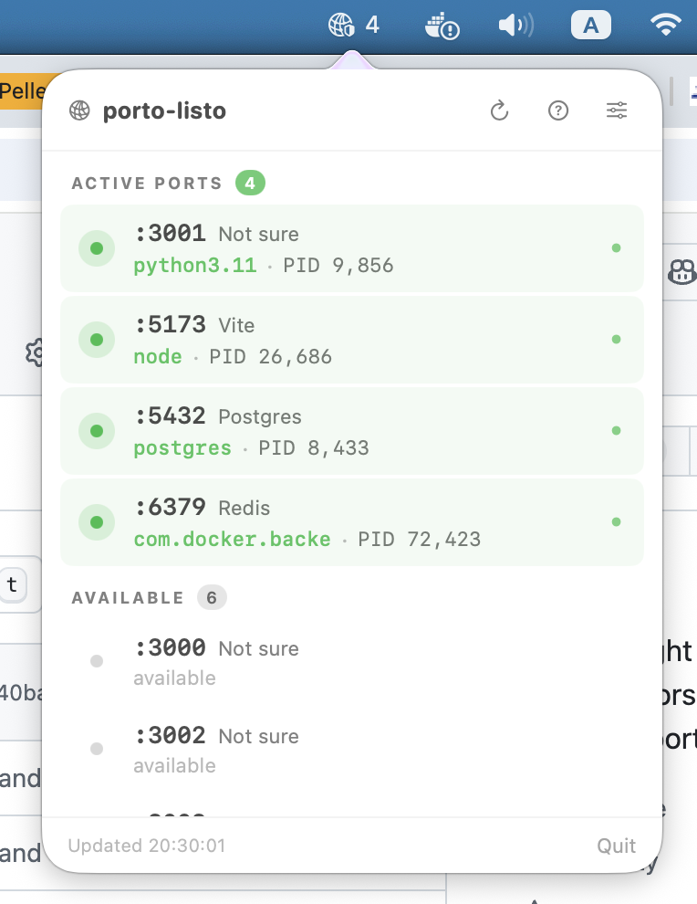
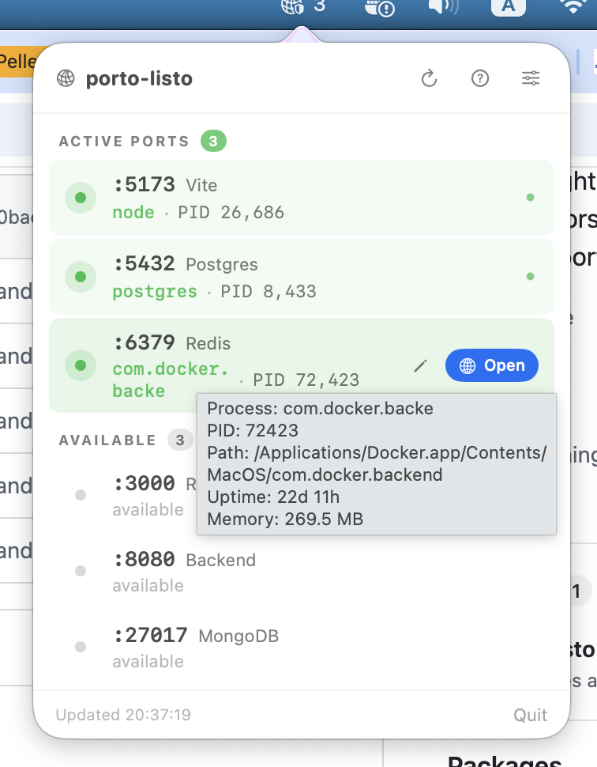
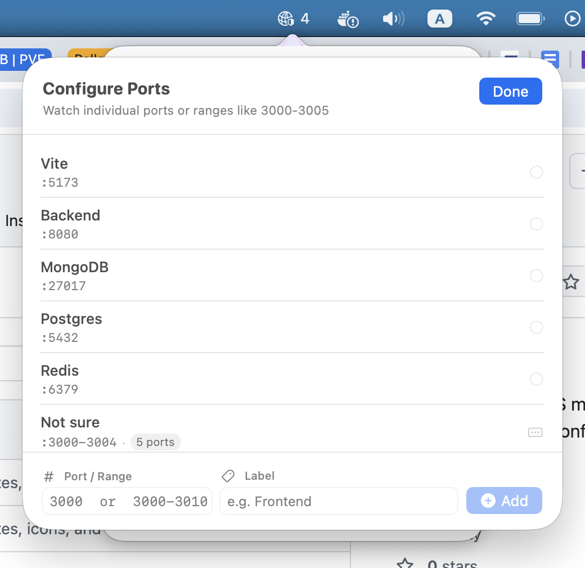

<p align="center">
  
</p>

<h1 align="center">PortoListo</h1>

<p align="center">
  A lightweight macOS menu bar app that shows which localhost ports are in use and what is running on them.
</p>

<p align="center">
  
</p>

## Screenshots

<p align="center">
  
  
  
</p>

## Features

- Finds running dev servers on its own and names them: `vite · my-app`, `uvicorn · backend`, Docker ports by their compose service (`redis · level-app-backend`)
- Leaves out macOS services, regular apps' helper ports (Spotify, VS Code…) and dynamic ports (49152+)
- Hide a port, or everything from one process; unhide in Settings
- Pin ports or ranges (e.g. `3000` or `3000-3010`) with your own labels to keep them listed when they stop
- See which process and PID owns each port
- Tooltip with what's running, working folder, process path, uptime, and memory usage
- Open active ports in your browser with one click
- Auto-refreshes every 5s when open, 60s in background

## Install

1. Download the latest `.dmg` from [Releases](../../releases)
2. Open it and drag **PortoListo** to Applications
3. **Important:** On first launch, macOS will block the app because it isn't notarized. To open it:
   - **Right-click** (or Control-click) on PortoListo in Applications
   - Select **Open** from the context menu
   - Click **Open** in the dialog that appears
   - You only need to do this once — subsequent launches work normally

   Alternatively, remove the quarantine flag via Terminal:
   ```bash
   xattr -d com.apple.quarantine /Applications/PortoListo.app
   ```

## Build from source

Requires Xcode 15+ and macOS 13+.

```bash
xcodebuild -scheme PortoListo -configuration Release build
```

The built app will be in `~/Library/Developer/Xcode/DerivedData/PortoListo-*/Build/Products/Release/PortoListo.app`.

## How it works

PortoListo walks each of your processes' open sockets through libproc (`proc_listallpids`, `proc_pidinfo`, `proc_pidfdinfo` — the same source `lsof` uses) to find TCP sockets in `LISTEN` state, then enriches each process with path, start time, and memory usage via lightweight Darwin syscalls (`proc_pidpath`, `sysctl`, `proc_pidinfo`). No root/sudo required.

## License

MIT
